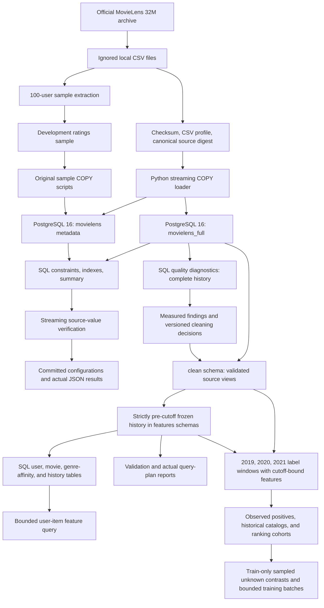

# Current local architecture

The two databases share one Docker PostgreSQL service and persistent named
volume. PostgreSQL owns relational storage, integrity constraints, indexing, and
the SQL validation summary. Python handles streaming files and value digests;
SQL also owns the quality checks and validated views, and will own the later
split and feature pipelines.

The COPY/INSERT benchmark is a separate ordinary table created and removed in
`movielens`; it does not mutate the real ratings. The full loader uses its own
database to preserve the functioning development sample.

SQL quality diagnostics and validated source views are implemented in the full
database. The quality runner profiles a repeatable-read snapshot and installs
views separately; the current rules exclude zero rows. Full-history activity
statistics are report diagnostics, not train-time features.

SQL feature tables and bounded pair lookups are implemented in separate
snapshot schemas in `movielens_full`. The main exploratory snapshot cuts history
strictly before 2020-01-01 UTC; it is not a training split. Static genre labels
are not historically versioned. Context's source-wide counts are diagnostic
metadata and do not enter the pair feature vector.

Chronological train/validation/test datasets are now implemented in
`datasets_calendar_v1`, using pre-2019/pre-2020/pre-2021 features respectively.
Training rows, held-out truth, and candidate rules are separate. Candidate item
sets use history only; outcome-conditioned ranking users and exclusions are
reported explicitly. Only initial training data feeds the sampler and training
batch helper. No dense evaluation user/catalog matrix is stored.

Models, ranking metric execution, and an API remain planned. No model performance
or full production-scale serving is claimed.
