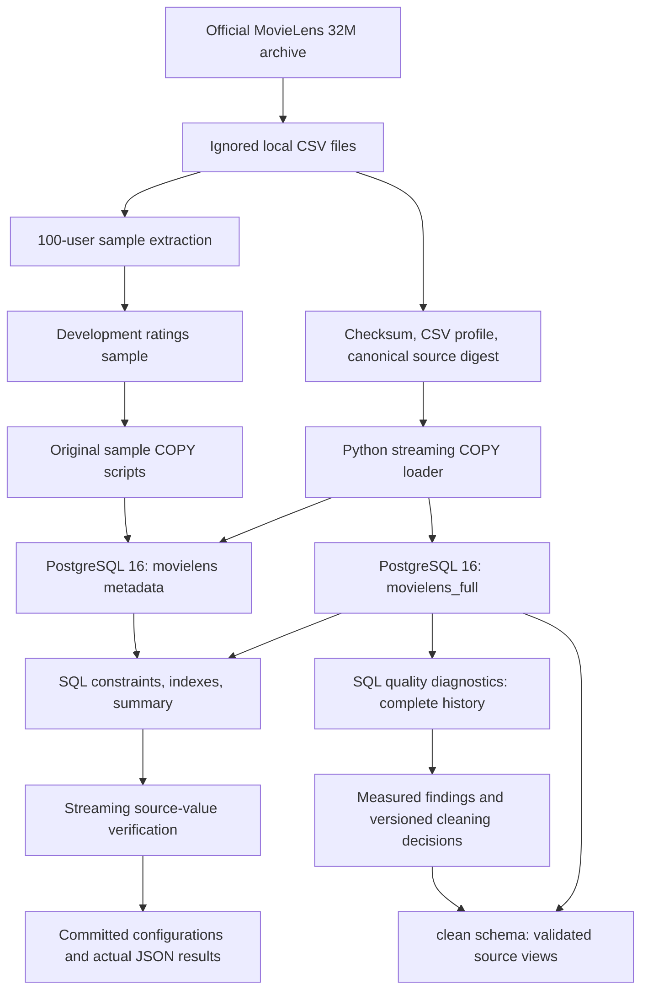

# Current local architecture

The two databases share one Docker PostgreSQL service and persistent named
volume. PostgreSQL owns relational storage, integrity constraints, indexing, and
the SQL validation summary. Python handles streaming files and value digests;
SQL also owns the quality checks and validated views, and will own the later
split and feature pipelines.

The COPY/INSERT benchmark is a separate ordinary table created and removed in
`movielens`; it does not mutate the real ratings. The full loader uses its own
database to preserve the functioning development sample.

SQL quality diagnostics and validated source views are implemented in the full
database. The quality runner profiles a repeatable-read snapshot and installs
views separately; the current rules exclude zero rows. Full-history activity
statistics are report diagnostics, not train-time features.

Models, chronological datasets, SQL feature tables, and an API are planned, not
implemented. No model performance or full production-scale serving is claimed.
